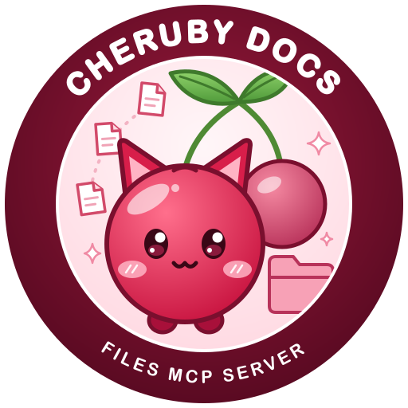

# Cheruby Docs for YunoHost

Read-only MCP tools that let AI agents list, find, read and search by meaning
one user's folders on the server. Meant to sit behind an MCP gateway.

## Tools

- `list_folder(path)`: a folder's subfolders, then its files with size and date.
- `find_files(query, path)`: files whose path holds every word, ignoring case and accents.
- `read_file(path, ...)`: text and Markdown by character range, PDF by page,
  Word and OpenDocument, and images as pictures.
- `search_documents(query, path, after, before, limit)`: passages by meaning
  and keywords, from an index rebuilt every hour.

Paths start with a folder's label, such as `Documents/Factures`.

## Install

The install asks for one user. Their folders are chosen afterwards in the
config panel, from two sources, each turned on or off:

- **Syncthing**: the folders Syncthing syncs on the server, ticked from a list
  (empty opens them all), each under its Syncthing label.
- **Local storage**: any folder, one per line as `<Label>=<path>`.

Each source also has "Only these files" and "Leave out" patterns, such as
`*.pdf`, `Archives` or `Documents/Old`. What they leave out cannot be listed,
found, read or searched. Under each source, the panel shows which folders hold
files the app cannot read.

The server listens on `http://127.0.0.1:<port>/mcp` (Streamable HTTP).

The gateway gets its own token, shown in the config panel under "Whoopy
token", with the address to paste beside it. It opens all the folders, or the
ones listed under "Whoopy access", and searches the user's index. "New token"
replaces it. The user also has a token of their own, on all the folders, read
with `yunohost app setting cheruby-docs-mcp token_<user>`.

The service joins each folder's group to read it, so the files must be
group-readable. Everything else on the server stays hidden from it, and it
can reach nothing but loopback.
